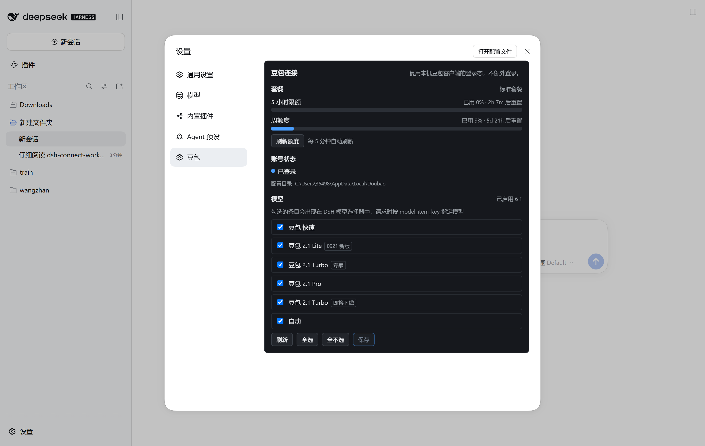
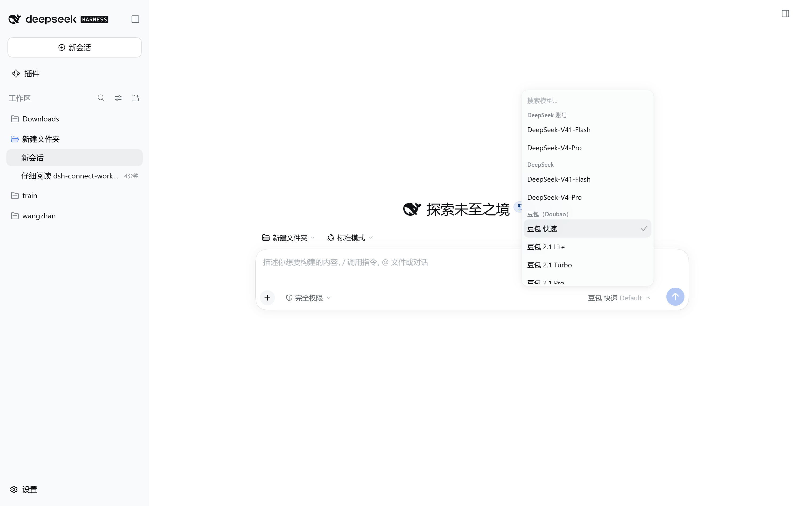

# DSH Connect Doubao

> Connect a **Doubao account** to DeepSeek Harness: **chat models** and
> **「工作任务」 (task-mode) models** (2.1 Lite / 2.1 Pro / Auto, which spend the paid
> membership quota), **Seedream image generation**, plus a **read-only** quota panel
> (5-hour window / weekly window / activity grant, each with a reset countdown).
> There is exactly one way in: **one browser QR sign-in**. Windows x64 only — the
> session is sealed locally with Windows DPAPI.

[](https://www.npmjs.com/package/dsh-connect-doubao)
[](./LICENSE)
[](https://dshfind.dev)



---

## ⚠️ Prerequisites (read first)

**There is exactly one way in: one browser QR sign-in. The Doubao desktop app is
neither required nor read.**

Pressing 「重新登录」 in the card opens a dedicated Chromium window on Doubao's login
page. Once you scan the code (or finish the phone-verification flow) the plugin
pulls the session cookies over CDP and seals them with Windows DPAPI into
`%USERPROFILE%\.dsh\doubao-credentials-browser.dpapi`. Only that one moment needs a
human; everything after it is plain HTTP.

| Requirement | Notes |
| --- | --- |
| **One QR sign-in** | Otherwise the card reports "not signed in" and the provider is unavailable |
| **Windows** | Sealing relies on Windows DPAPI. **macOS / Linux are not supported** |
| Chrome or Edge installed | That window IS the sign-in surface; the default install path is enough |
| Some subscription quota | A free account connects too, but the quota is small |

With no session the plugin fails loudly ("还没有浏览器登录态…") rather than silently.

---

## Features

- **The model list is the client's own menu, not a hardcoded table** — the plugin reads
  `Default/Preferences` → `saman.local_storage_for_web['frontend-request-cache']`, so new
  models, new prices and new level ladders appear without a plugin release. Measured
  2026-11-12: 12 models (2 对话-mode, 9 「工作任务」-mode, 1 alias) plus the image alias.
- **Billing multipliers, verbatim** — the menu's `tag_list` is shown unchanged: `0.65x`,
  `0.46x` etc. as plain multipliers, `限时优惠 0.01x` / `小额免费` as campaign tags (outlined
  so a promo cannot read as the standing price). Display only: the plugin does not bill
  and cannot verify the actual charge.
- **Per-model thinking ladders** — `reasoning_effort_config.option_list` is per model and
  not uniform: GLM publishes 低/高/最高 (3/5/7), 2.1 Lite 低/中/高 (3/4/5), and Auto even puts
  「中」 on ordinal **8**. The picker and `thinkingLevelMap` are built from that ladder, so
  no level is offered that a model has no answer for. Solid chip = measured on a real
  request (3/4/5); dotted = declared by the menu only (6 极高 / 7 最高).
- **Deep thinking on by default** — no extra switch: non-task models send
  `need_deep_think: 3` on every turn, task models keep the captured `10001`. Set
  `DSH_DOUBAO_DEEP_THINK=0` to turn it back off.
- **Read-only quota panel** — 5-hour, weekly and activity-grant windows as bars, each
  with a **reset countdown**; manual refresh plus a 5-minute automatic poll.
- **Model checklist** — ticked entries appear in DSH's model picker and are sent as
  `model_item_key`.
- **Account status line** — distinguishes signed in / not signed in / sign-in could
  not be read, each with its own remedy.
- **Loopback shim** — chat traffic goes through a `127.0.0.1`-only endpoint guarded by a
  per-process secret; every non-loopback request is refused.
- **CLI diagnostics** — `doctor` and `probe` check the whole chain without spending
  inference quota.

---

## Verified

**Environment** (one specific real-machine configuration — not a promise that it
works everywhere):

| Item | Value |
| --- | --- |
| OS | Windows x64 |
| Doubao desktop app | 2.31.4 (signed in) |
| DeepSeek Harness | 0.2.0-rc.2 (desktop) |
| Node.js | 24.18.1 (inside the host) |

### Proven by real screenshots

- ✅ **The card mounts in the settings left-hand navigation** — a first-level "Doubao"
  entry appears in the settings nav; clicking it shows this card in the content pane.
- ✅ **The quota panel reads real data** — the screenshot shows `标准套餐`,
  `5 小时限额 已用 0% · 2h 17m 后重置`, `周额度 已用 9% · 5d 21h 后重置`,
  `账号状态: 已登录`, `每 5 分钟自动刷新`, and the profile path.
- ✅ **All six catalog entries render** — 豆包 快速 / 2.1 Lite (`0921 新版`) /
  2.1 Turbo (`专家`) / 2.1 Pro / 2.1 Turbo (`即将下线`) / 自动, with badges matching
  the desktop app and a count of `已启用 6 ↑`.
  > This screenshot is from **0.4.0**: back then the task-mode models were only
  > rendered, not wired up, and the badges used the client's own names. Since 0.4.1
  > they carry the `工作任务` badge and actually answer; the screenshot is not re-shot.
- ✅ **A 「豆包（Doubao）」 group appears in DSH's model picker** with the entries
  listed individually. This is the **end-to-end evidence that provider registration
  and the catalog both work**.
- ✅ **The checklist is interactive** — one checkbox per row plus `刷新` / `全选` /
  `全不选` / `保存` buttons.



### Code- and packet-level evidence (not screenshots)

- `doctor` passes all five checks: 29 cookies read from the sealed session with 9/9
  required session cookies present, the account accepted upstream, the shim bound to a loopback port with
  a wrong bearer refused (401), all three quota windows readable, and 6 models offered.
- Reasoning effort low=3 / mid=4 / high=5 was read by **diffing the configuration the
  client re-serialises when the level is switched**, then independently confirmed
  against `reasoning_effort_config` in the client's own config.
- The request body carries `model_item_key` and `reasoning_effort`: confirmed by capture.

### What this does NOT mean

All of the above holds for **that machine, that account, at the moment it was tested**.
It is **not a compatibility guarantee** — please read the Known limitations below.

---

## Model catalog

The catalog is read from the Doubao client's own configuration cache (`menuConfV2`,
the document the server hands the app) — not reconstructed by guesswork. The
`model_item_key` **is** the DSH model id, on purpose: one string instead of a
translation layer that could only be wrong.

| id | name | badge | mode | reasoning |
| --- | --- | --- | --- | --- |
| `0` | 豆包 快速 | — | 对话 | ✅ |
| `3` | 豆包 2.1 Turbo | `专家` | 对话 | ✅ |
| `seed-lite-7b` | 豆包 2.1 Lite | `工作任务` | 工作任务 | ✅ |
| `5` | 豆包 2.1 Pro | `工作任务` | 工作任务 | ✅ |
| `9` | 自动 | `工作任务` | 工作任务 | ✅ |

The three `工作任务` rows switch the request into task mode (`mode_id: "3"`,
`agent_mode: 1`, `need_deep_think: 10001`) and are answered by the plugin's own
`tool_local` responder — see 「工作任务」 mode below. They are the entries that spend
the **paid membership quota**.

**Reasoning effort**: low = `3`, mid = `4`, high = `5`. These values were read by
**diffing the configuration the client re-serialises when the level is switched**,
then independently confirmed against `reasoning_effort_config` in the client's own
config. They are observed, not inferred.

**The deep-thinking switch is ON by default** (since 2026-11-07): non-task models send
`need_deep_think: 3` together with `ext.use_deep_think: "3"`, while the task models
(2.1 Lite / Pro / Auto) keep the `10001` shape captured from the official client.
`DSH_DOUBAO_DEEP_THINK=0` restores the ordinary non-thinking turn. The effort level
still travels only as `reasoning_effort`; the switch is a separate axis.

「豆包 快速」 **does not think**: with the switch fully on and effort at high its reply is
still `thinking: false` and the stream carries no `10040` container, so it is marked
non-reasoning and the picker no longer offers low/mid/high for it.

> **Why the thinking is not visible**: with the switch on the server really does think —
> the response carries a `10040` thinking container and a `10091` elapsed block — but the
> **reasoning text is never sent**. Confirmed 2026-11-07 by capturing the official client:
> the container's child block holds only `summary: "正在思考"`, and the answer blocks hold
> only the answer. This is an endpoint limitation, not text this plugin drops.

> 「即将下线」 is not a property of the Turbo model: the app publishes **two** Turbo
> entries and only the retiring one carries that badge. The retiring one (`4`) is
> the only entry withheld from the picker.

---

## How it works

```
DSH (pi-ai provider)
  └─ doubao-adapter ──► local loopback shim (127.0.0.1, per-process secret)
                         └─ doubao-upstream ──► Doubao /chat/completion
                                                 (with the cookie from the sealed session)
```

1. **Credentials** come only from the browser sign-in: one CDP `Storage.getCookies`
   call, sealed immediately with Windows DPAPI into
   `~/.dsh/doubao-credentials-browser.dpapi`. The values reach the outbound request
   header and nothing else — never logs, argv, the environment or another file.
2. **Provider** translates pi-ai's OpenAI-shaped request into Doubao's dialect
   (`bot_id` + `reasoning_effort`).
3. **Streaming** — upstream's three-line frames are parsed into pi-ai's event stream;
   tool calls, compaction and permissions stay Harness-owned.
4. **Task mode** — for the `工作任务` entries, `doubao-upstream` additionally runs a
   `tool_local` responder: it polls the server's `msg/ack` **one `msg_id` at a time**
   (a batch containing a not-yet-generated seq fails the whole batch with
   `710010702`), answers `cmd_call` via `upload_command_result` + `msg/complete`, and
   stops on `agent_finished`. Incremental `CHUNK_DELTA` frames are split into
   thinking/answer by their block id.
5. **Read-only routes** — `/plugins/dsh-connect-doubao/quota` and `/catalog` serve quota
   and catalog from an **explicit allow-list** (no upstream field is passed through),
   and refuse non-loopback origins.

---

## Installation

```bash
# ① via the DSH CLI (recommended)
dsh plugin --profile desktop add dsh-connect-doubao

# ② from npm
npm install -g dsh-connect-doubao
dsh plugin --profile desktop add dsh-connect-doubao

# ③ local development (never published; links the source directory)
dsh plugin --profile desktop add "E:\path\to\dsh-connect-doubao"
```

> Option ③ writes a `link:` dependency — after editing the sources, just run
> `npm run build`; no reinstall is needed.

### Supported host range

| Component | Version |
| --- | --- |
| DeepSeek Harness | `>=0.1.7-rc.1 <0.3.0-0` (verified on `0.2.0-rc.2`) |
| `@earendil-works/pi-ai` | `>=0.85.0 <0.88.0` (host runs `0.87.1`) |
| Node.js | `^22.19.0 \|\| >=24.0.0` |

All official `@deepseek-ai/*` dependencies are declared as **`peerDependencies`**
(never bundled, always the host's copy) — which is both a hard requirement of the
plugin marketplace and what keeps runtime types consistent.

---

## Platform support

| Platform | Status |
| --- | --- |
| **Windows x64** | ✅ **verified on real hardware** |
| macOS | ❌ unsupported (DPAPI is Windows-only) |
| Linux | ❌ unsupported (same) |

**Session** — one source only (`src/doubao-auth.ts` + `src/doubao-auth-browser.ts`):

1. the card's 「重新登录」 launches a dedicated Chromium profile
   (`~/.dsh/doubao-browser-profile`) on `https://www.doubao.com/chat/`;
2. you scan the code, and the plugin collects every cookie with one CDP
   `Storage.getCookies` call;
3. only the Doubao/Bytedance cookies are kept, and only if all 9 required session
   cookies are there; the result is sealed with Windows DPAPI into
   `%USERPROFILE%\.dsh\doubao-credentials-browser.dpapi` (current-user scope — another
   account or machine cannot open it);
4. every later request reads that file, cached in-process for 10 minutes.

**Why the client's cookie jar is no longer decrypted.** While the Doubao client runs it
holds `Default\Network\Cookies` with an EXCLUSIVE lock — and this plugin exists for
exactly that account. The read failed, the code fell back to a 12-hour-old sealed copy,
the server had long rotated the session, and every request was rejected upstream while
the local state still claimed "signed in", leaving the user nothing to act on. The
browser sign-in has no such corner: the cookies are captured live, and what gets sealed
is what was just captured, so there is no older copy to prefer.

**Data directory (unrelated to the session).** `listDoubaoProfiles`
(`src/doubao-profile.ts`) tries, cheapest first: `profileDir` from the settings file /
`DSH_DOUBAO_PROFILE` → AppData candidates → the running client's `--user-data-dir` →
a time-boxed drive scan. It now feeds only the client-cache model discovery and the
task-mode workspace; when it finds nothing the workspace falls back to a temp directory
and chat still works.

`node lib/cli-doctor.js --json` still reports where that directory came from
(`credentials.data.profile`, with its source) and every candidate it saw
(`credentials.data.candidates`).

---

## Command line

```bash
# check the whole chain without spending inference quota
dsh-connect-doubao-doctor
dsh-connect-doubao-doctor --json

# smoke probe (spends one inference request)
dsh-connect-doubao-probe --prompt "hi"
dsh-connect-doubao-probe --prompt "hi" --model 5 --thinking high --json
```

Full `probe` flags:

```
--prompt <text>              the prompt (default "hi")
--model <key>                model id from the table above
--thinking <low|mid|high>    reasoning effort
--json                       emit JSON
--timeout <ms>               timeout (default 120000)
```

`doctor` reports five independent checks: credentials / account / provider assembly /
quota / model discovery. It prints **counts only**, never values.

---

## Development

```bash
npm install
npm run typecheck   # node-side and browser-side tsconfigs
npm run build       # two targets: node (ESM) + browser (CJS)
npm run test        # client bundle format regression
npm run check       # all of the above
```

> ⚠️ The browser bundle **must be CommonJS**: the desktop shell loads it with a
> `<script>` tag and no `type="module"`. An ESM bundle throws
> `Cannot use import statement outside a module` and fails the whole web boot
> (`1 entry did not activate`). `tests/client-bundle-format.test.ts` pins that rule.

---

## Known limitations (please set expectations honestly)

1. **It uses a non-public interface.** Doubao publishes no third-party API; this
   plugin reverses the behaviour of its own client. Any upstream change can break it,
   without notice.
2. **`'4'` (豆包 2.1 Turbo, "即将下线") is unverified** — and withheld from the
   picker. The other 5 entries were exercised in real conversations, including both
   task-mode models.
3. **Task mode works, but whether a turn is billed depends on what it did.** In task
   mode the server hands each turn to `Agent-GeneralTask`, and the plugin runs a
   `tool_local` responder alongside (`msg/ack` → `upload_command_result` →
   `msg/complete`) so the local workspace commands complete instead of failing with
   `710010702`. **For a plain-text turn that triggers no local tool, the server marks
   the round `general_agent_task_mode: "simple"` with `mode_downgrade_reason: "success"`,
   and the activity-grant `usedAmount` does not move** (measured: unchanged at 782
   across a call — i.e. downgraded, not billed). To actually spend the paid quota, the
   turn has to do multi-step tool/document work. This is a measurement, not a promise.
4. **There is no response-side field that proves "the server really used that model".**
   The upstream SSE carries an opaque marker in `message.ext` (observed as `38`); it is
   **not** a version number or a tier, and ByteDance has never published its meaning.
   What this plugin can establish is that it sends `model_item_key` with the request
   (confirmed by packet capture). How the server interprets that key is the server's
   own business — sending an invented key still returns HTTP 200, so the field is not
   validated. What 0.4.1 offers is **the whole task-mode request shape for a given
   key** (verified to answer), not a guarantee that Pro rather than Lite did the work.
5. **Windows only** — the session is sealed with DPAPI. The Doubao app does **not**
   have to be installed: the session comes from the browser sign-in. `User Data` is only
   read for model discovery and the task-mode workspace (see the lookup above); when it
   is missing the workspace falls back to a temp directory and the session is unaffected.
6. **Risk-control sliders cannot be automated.** When one fires, complete it in the
   sign-in window that just opened, then press 「重新登录」 again.
7. **No image input.** The provider sends text blocks only.
8. **Single account.** No account pool, no region switching, no check-in.

---

## Disclaimer

For **personal study and research only**.

- By using this plugin you agree to comply with the **Doubao terms of service**;
- Use at your own risk; **the author accepts no liability** for account bans, quota
  loss, or any other consequence;
- This project is **not affiliated with or endorsed by ByteDance, DeepSeek, or the
  DeepSeek Harness maintainers**;
- Not for commercial use or any purpose beyond personal study.

---

## Acknowledgements

- **dsh-connect-workbuddy** — this plugin borrowed its **design ideas and plugin
  structure** (loopback shim, provider registration path, settings-card mounting,
  build and packaging conventions). **All code is an independent implementation**;
  none of its source was copied.

## Third-party dependencies

| Dependency | Purpose |
| --- | --- |
| `@earendil-works/pi-ai` | model provider runtime (host-provided) |
| `@deepseek-ai/*` | Harness plugin framework (host-provided) |
| `@deepseek-ai/schemastery` | settings schema (host-provided) |

No third-party connector plugin is a runtime dependency.

## License

[MIT](./LICENSE)
