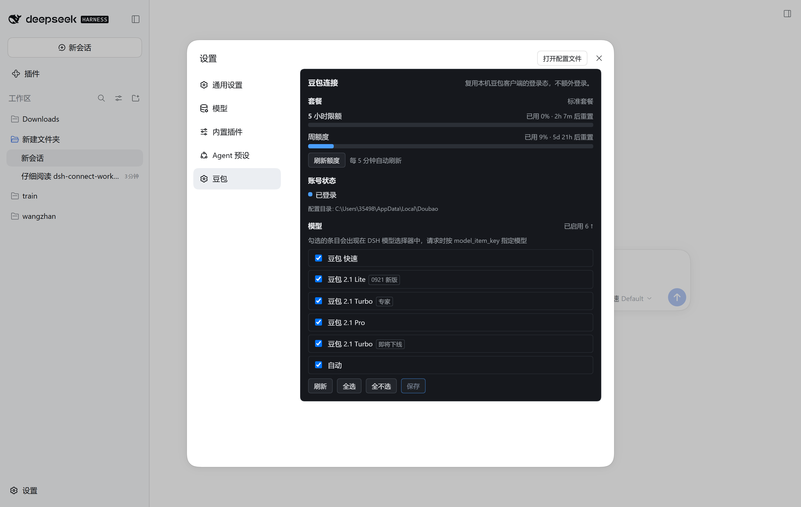
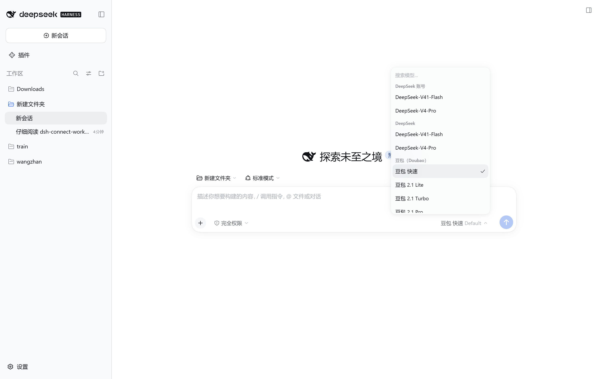

# DSH Connect Doubao

> Connect the sign-in **already held by the local Doubao desktop app** to DeepSeek
> Harness as a Seed-family model provider, plus a **read-only** quota view
> (5-hour window / weekly window, with reset countdowns).

[](https://www.npmjs.com/package/dsh-connect-doubao)
[](./LICENSE)
[](https://dshfind.dev)



---

## ⚠️ Prerequisites (read first)

**This plugin reuses the sign-in already held by the Doubao desktop app, so you
must be signed in to that app first.**

It never signs in for you and never asks for credentials: it reads the Chromium
cookie jar the app already keeps on this machine (decrypted in-process via
Windows DPAPI) and uses it as the request credential.

| Requirement | Notes |
| --- | --- |
| **Signed in to the Doubao desktop app** | Otherwise the card reports "not signed in" and the provider is unavailable |
| **Windows** | Credential decryption relies on Windows DPAPI. **macOS / Linux are not supported** |
| Some subscription quota | A free account connects too, but the quota is small |

Without a signed-in Doubao app the plugin fails loudly rather than silently.

---

## Features

- **Seed-family models** — the 6 entries the Doubao desktop app publishes (table below),
  exposed as a DSH model provider.
- **Three reasoning-effort levels** — low / mid / high, mapped to the measured upstream
  `reasoning_effort` values **3 / 4 / 5**.
- **Read-only quota panel** — 5-hour and weekly windows as two bars, each with a
  **reset countdown**; manual refresh plus a 5-minute automatic poll.
- **Model checklist** — ticked entries appear in DSH's model picker and are sent as
  `model_item_key`.
- **Account status line** — distinguishes signed in / not signed in / sign-in could
  not be read, each with its own remedy.
- **Loopback shim** — chat traffic goes through a `127.0.0.1`-only endpoint guarded by a
  per-process secret; every non-loopback request is refused.
- **CLI diagnostics** — `doctor` and `probe` check the whole chain without spending
  inference quota.

---

## Verified

**Environment** (one specific real-machine configuration — not a promise that it
works everywhere):

| Item | Value |
| --- | --- |
| OS | Windows x64 |
| Doubao desktop app | 2.31.4 (signed in) |
| DeepSeek Harness | 0.2.0-rc.2 (desktop) |
| Node.js | 24.18.1 (inside the host) |

### Proven by real screenshots

- ✅ **The card mounts in the settings left-hand navigation** — a first-level "Doubao"
  entry appears in the settings nav; clicking it shows this card in the content pane.
- ✅ **The quota panel reads real data** — the screenshot shows `标准套餐`,
  `5 小时限额 已用 0% · 2h 17m 后重置`, `周额度 已用 9% · 5d 21h 后重置`,
  `账号状态: 已登录`, `每 5 分钟自动刷新`, and the profile path.
- ✅ **All six catalog entries render** — 豆包 快速 / 2.1 Lite (`0921 新版`) /
  2.1 Turbo (`专家`) / 2.1 Pro / 2.1 Turbo (`即将下线`) / 自动, with badges matching
  the desktop app and a count of `已启用 6 ↑`.
- ✅ **A 「豆包（Doubao）」 group appears in DSH's model picker** with the six entries
  listed individually. This is the **end-to-end evidence that provider registration
  and the catalog both work**.
- ✅ **The checklist is interactive** — one checkbox per row plus `刷新` / `全选` /
  `全不选` / `保存` buttons.



### Code- and packet-level evidence (not screenshots)

- `doctor` passes all four checks: 29 cookies decrypted with 9/9 required session
  cookies present, the account accepted upstream, the shim bound to a loopback port with
  a wrong bearer refused (401), and both quota windows readable.
- Reasoning effort low=3 / mid=4 / high=5 was read by **diffing the configuration the
  client re-serialises when the level is switched**, then independently confirmed
  against `reasoning_effort_config` in the client's own config.
- The request body carries `model_item_key` and `reasoning_effort`: confirmed by capture.

### What this does NOT mean

All of the above holds for **that machine, that account, at the moment it was tested**.
It is **not a compatibility guarantee** — please read the Known limitations below.

---

## Model catalog

The catalog is read from the Doubao client's own configuration cache (`menuConfV2`,
the document the server hands the app) — not reconstructed by guesswork. The
`model_item_key` **is** the DSH model id, on purpose: one string instead of a
translation layer that could only be wrong.

| id | name | badge | reasoning |
| --- | --- | --- | --- |
| `0` | 豆包 快速 | — | ✅ |
| `seed-lite-7b` | 豆包 2.1 Lite | `0921 新版` | ✅ |
| `3` | 豆包 2.1 Turbo | `专家` | ✅ |
| `5` | 豆包 2.1 Pro | — | ✅ |
| `4` | 豆包 2.1 Turbo | `即将下线` | ✅ |
| `9` | 自动 | — | ✅ |

**Reasoning effort**: low = `3`, mid = `4`, high = `5`. These values were read by
**diffing the configuration the client re-serialises when the level is switched**,
then independently confirmed against `reasoning_effort_config` in the client's own
config. They are observed, not inferred.

> 「即将下线」 is not a property of the Turbo model: the app publishes **two** Turbo
> entries and only the retiring one carries that badge.

---

## How it works

```
DSH (pi-ai provider)
  └─ doubao-adapter ──► local loopback shim (127.0.0.1, per-process secret)
                         └─ doubao-upstream ──► Doubao /chat/completion
                                                 (with the locally-read session cookie)
```

1. **Credentials** are read from the Doubao client's Chromium cookie jar and decrypted
   with Windows DPAPI **in-process**. Cookie values never reach disk, logs, the command
   line, or anywhere outside the outbound request.
2. **Provider** translates pi-ai's OpenAI-shaped request into Doubao's dialect
   (`bot_id` + `reasoning_effort`).
3. **Streaming** — upstream's three-line frames are parsed into pi-ai's event stream;
   tool calls, compaction and permissions stay Harness-owned.
4. **Read-only routes** — `/plugins/dsh-connect-doubao/quota` and `/catalog` serve quota
   and catalog from an **explicit allow-list** (no upstream field is passed through),
   and refuse non-loopback origins.

---

## Installation

```bash
# ① via the DSH CLI (recommended)
dsh plugin --profile desktop add dsh-connect-doubao

# ② from npm
npm install -g dsh-connect-doubao
dsh plugin --profile desktop add dsh-connect-doubao

# ③ local development (never published; links the source directory)
dsh plugin --profile desktop add "E:\path\to\dsh-connect-doubao"
```

> Option ③ writes a `link:` dependency — after editing the sources, just run
> `npm run build`; no reinstall is needed.

### Supported host range

| Component | Version |
| --- | --- |
| DeepSeek Harness | `>=0.1.7-rc.1 <0.3.0-0` (verified on `0.2.0-rc.2`) |
| `@earendil-works/pi-ai` | `>=0.85.0 <0.88.0` (host runs `0.87.1`) |
| Node.js | `^22.19.0 \|\| >=24.0.0` |

All official `@deepseek-ai/*` dependencies are declared as **`peerDependencies`**
(never bundled, always the host's copy) — which is both a hard requirement of the
plugin marketplace and what keeps runtime types consistent.

---

## Platform support

| Platform | Status |
| --- | --- |
| **Windows x64** | ✅ **verified on real hardware** |
| macOS | ❌ unsupported (DPAPI is Windows-only) |
| Linux | ❌ unsupported (same) |

Credential lookup (`findDoubaoUserDataDir`) tries, in order:

1. `%LOCALAPPDATA%\Doubao\User Data`
2. `%APPDATA%\Doubao\User Data`
3. `C:\Users\<each user>\AppData\Local\Doubao\User Data`

A candidate matches when `Default\Network\Cookies` exists.
**Only the first is verified on a real machine**; 2 and 3 are fallback branches in the
code and are explicitly *not* validated on hardware.

---

## Command line

```bash
# check the whole chain without spending inference quota
dsh-connect-doubao-doctor
dsh-connect-doubao-doctor --json

# smoke probe (spends one inference request)
dsh-connect-doubao-probe --prompt "hi"
dsh-connect-doubao-probe --prompt "hi" --model 5 --thinking high --json
```

Full `probe` flags:

```
--prompt <text>              the prompt (default "hi")
--model <key>                model id from the table above
--thinking <low|mid|high>    reasoning effort
--json                       emit JSON
--timeout <ms>               timeout (default 120000)
```

`doctor` reports four independent checks: credentials / account / provider assembly /
quota. It prints **counts only**, never values.

---

## Development

```bash
npm install
npm run typecheck   # node-side and browser-side tsconfigs
npm run build       # two targets: node (ESM) + browser (CJS)
npm run test        # client bundle format regression
npm run check       # all of the above
```

> ⚠️ The browser bundle **must be CommonJS**: the desktop shell loads it with a
> `<script>` tag and no `type="module"`. An ESM bundle throws
> `Cannot use import statement outside a module` and fails the whole web boot
> (`1 entry did not activate`). `tests/client-bundle-format.test.ts` pins that rule.

---

## Known limitations (please set expectations honestly)

1. **It uses a non-public interface.** Doubao publishes no third-party API; this
   plugin reverses the behaviour of its own client. Any upstream change can break it,
   without notice.
2. **`'4'` (豆包 2.1 Turbo, "即将下线") is unverified.** The other 5 entries were
   exercised in real conversations.
3. **There is no response-side field that proves "the server really used that model".**
   The upstream SSE carries an opaque marker in `message.ext` (observed as `38`); it is
   **not** a version number or a tier, and ByteDance has never published its meaning.
   What this plugin can establish is that it sends `model_item_key` with the request
   (confirmed by packet capture). How the server interprets that key is the server's
   own business.
4. **Windows only** — credential decryption relies on DPAPI.
5. **Risk-control sliders cannot be automated.** When one fires, send one message in
   the Doubao desktop app to clear it.
6. **No image input.** The provider sends text blocks only.
7. **Single account.** No account pool, no region switching, no check-in.

---

## Disclaimer

For **personal study and research only**.

- By using this plugin you agree to comply with the **Doubao terms of service**;
- Use at your own risk; **the author accepts no liability** for account bans, quota
  loss, or any other consequence;
- This project is **not affiliated with or endorsed by ByteDance, DeepSeek, or the
  DeepSeek Harness maintainers**;
- Not for commercial use or any purpose beyond personal study.

---

## Acknowledgements

- **dsh-connect-workbuddy** — this plugin borrowed its **design ideas and plugin
  structure** (loopback shim, provider registration path, settings-card mounting,
  build and packaging conventions). **All code is an independent implementation**;
  none of its source was copied.

## Third-party dependencies

| Dependency | Purpose |
| --- | --- |
| `@earendil-works/pi-ai` | model provider runtime (host-provided) |
| `@deepseek-ai/*` | Harness plugin framework (host-provided) |
| `@deepseek-ai/schemastery` | settings schema (host-provided) |

No third-party connector plugin is a runtime dependency.

## License

[MIT](./LICENSE)
