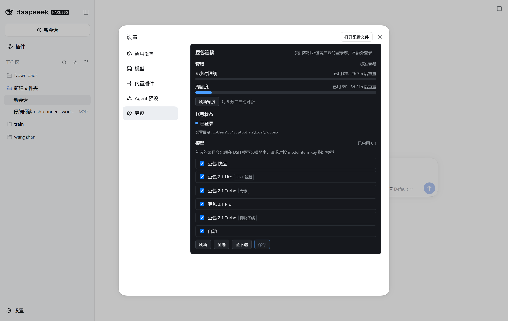
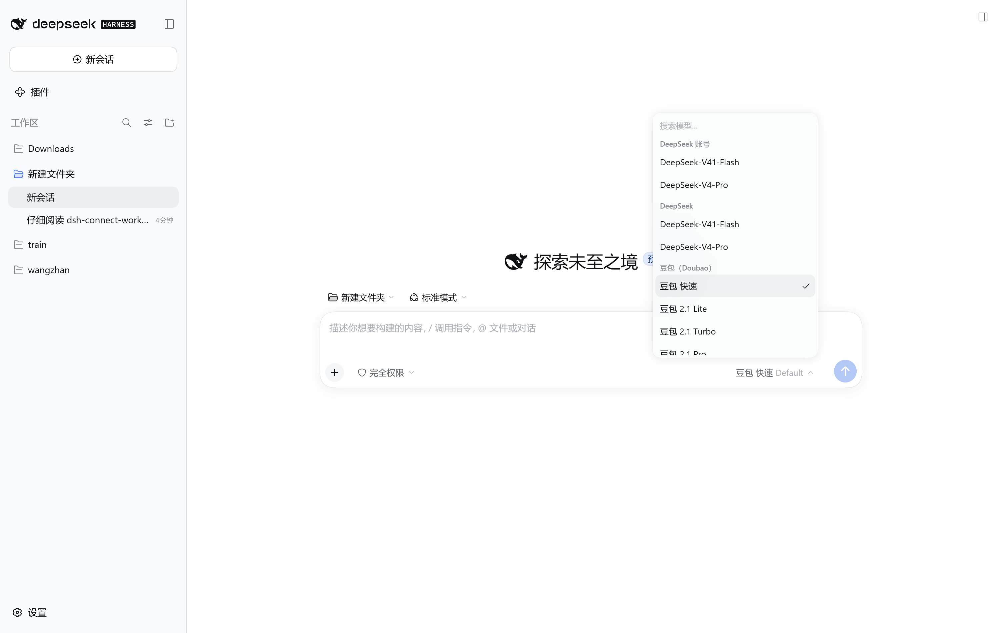

# DSH Connect Doubao

> 把**本机豆包（Doubao）桌面客户端已有的登录态**接入 DeepSeek Harness，作为 Seed 系列模型 provider，
> 并在设置面板里提供一个**只读**的额度概览（5 小时限额 / 周额度 + 重置倒计时）。

[](https://www.npmjs.com/package/dsh-connect-doubao)
[](./LICENSE)
[](https://dshfind.dev)



---

## ⚠️ 前置条件（必读）

**本插件复用豆包桌面客户端的登录态，因此必须先在豆包客户端登录。**

它不会替你登录、也不会输入任何账号密码：它读取豆包客户端已保存在本机的
Chromium cookie（通过 Windows DPAPI 在本进程内解密），把它当作请求凭据。

| 要求 | 说明 |
| --- | --- |
| **豆包桌面客户端已登录** | 未登录 → 卡片显示「未登录」，provider 不可用 |
| **Windows** | 凭据解密依赖 Windows DPAPI。macOS / Linux **不支持** |
| 有可用订阅额度 | 免费账号也能连，但配额很小 |

如果你没有登录豆包客户端，插件会明确报错而不是静默失败。

---

## 功能特性

- **豆包对话接入** —— 对话模式真正可用的两个条目（见下表），作为 DSH 的模型 provider。
- **生图（Seedream 5.0）** —— 模型选择器里选「豆包 生图」，回复即以 Markdown 图片返回真实生成图，可直接下载落盘。2026-11-02 实测端到端通过。
- **推理强度三档** —— 低 / 中 / 高，对应上游 `reasoning_effort` 实测值 **3 / 4 / 5**。
- **只读额度面板** —— 5 小时限额与周额度两条进度条，各带**重置倒计时**；设置面板里手动刷新 + 5 分钟自动刷新。
- **模型勾选清单** —— 勾选的条目会出现在 DSH 的模型选择器中，请求时按 `model_item_key` 指定模型。
- **账号状态行** —— 区分「已登录 / 未登录 / 登录信息读不出来」等状态，各自给出不同的处置建议。
- **独立 loopback shim** —— 对话请求走一个只监听 `127.0.0.1` 的本地端点，带每进程共享密钥，任何非本机请求一律拒绝。
- **命令行诊断** —— `doctor` / `probe`，不消耗推理额度即可体检整条链路。

---

## 已验证

**验证环境**（一次具体的真机条件，不是"所有环境都可用"的承诺）：

| 项 | 值 |
| --- | --- |
| 操作系统 | Windows x64 |
| 豆包电脑版 | 2.31.4（已登录） |
| DeepSeek Harness | 0.2.0-rc.2（桌面版） |
| Node.js | 24.18.1（宿主内） |

### 真机截图证明（用户实拍）

- ✅ **卡片挂在设置左侧导航里** —— 设置面板左栏出现「豆包」一级导航项，点击后右侧显示本卡片。
- ✅ **额度面板读到真实数据** —— 截图里可见 `标准套餐`、`5 小时限额 已用 0% · 2h 17m 后重置`、
  `周额度 已用 9% · 5d 21h 后重置`、`账号状态: 已登录`、`每 5 分钟自动刷新`、配置目录路径。
- ✅ **模型清单六个条目全部渲染** —— 豆包 快速 / 2.1 Lite（`0921 新版`）/ 2.1 Turbo（`专家`）/
  2.1 Pro / 2.1 Turbo（`即将下线`）/ 自动，角标与桌面包一致，计数显示 `已启用 6 ↑`。
- ✅ **模型选择器里出现「豆包（Doubao）」分组** —— 六个条目逐一列出。
  这是 **provider 注册成功 + catalog 生效** 的端到端证据。
- ✅ **勾选交互可用** —— 每行一个勾选框，配 `刷新` / `全选` / `全不选` / `保存` 四个按钮。



### 代码级 / 抓包级证据（非截图）

- `doctor` 四段检查全绿：凭据 29 cookie 解密且 9/9 必需会话 cookie 齐备、账号被上游接受、
  shim 绑定回环端口且错误 bearer 返回 401、两个额度窗口可读。
- 推理强度 低=3 / 中=4 / 高=5：由**抓取客户端切换档位时重新序列化的配置 diff**读出，
  并由客户端配置里的 `reasoning_effort_config` 独立确认。
- 请求体带 `model_item_key` 与 `reasoning_effort`：抓包确认。

### 这不代表什么

以上只对**上述那台机器、那个账号、被验证的那个时间点**成立。
**不构成任何兼容性保证** —— 请务必读下面的「已知限制」。

---

## 模型目录

豆包把模型按**模式**分组，`menu_list` 每个模式有自己的一份清单：

| 模式 | 可选条目 |
| --- | --- |
| 对话 | 豆包 快速（`0`）、豆包 2.1 Turbo「专家」（`3`） |
| 工作任务 | 自动（`9`）、2.1 Lite（`seed-lite-7b`）、2.1 Pro（`5`）、Turbo（`3`） |

**本插件只提供「对话」模式的两条**：

| id | 名称 | 徽章 | 推理强度 |
| --- | --- | --- | --- |
| `0` | 豆包 快速 | — | ✅ |
| `3` | 豆包 2.1 Turbo | `专家` | ✅ |

「工作任务」的四条**故意不列**：它们的执行侧是豆包客户端进程内的 CUA 运行时
（`tasks-mode-resource` + `sbox`），外部客户端注册不进去，每一轮都会得到
`710010702`。与其在模型选择器里摆出选不中的条目，不如不摆。

**推理强度**：低 = `3`、中 = `4`、高 = `5`（由客户端切换档位时重新序列化的配置 diff 读出，
并由配置里的 `reasoning_effort_config` 独立确认）。深度思考开关本身走
`need_deep_think: 0`，档位只由 `reasoning_effort` 携带 —— 这是 2026-10-22 CDP 抓包更正的。

---

## 生图（技能轴，与模型轴正交）

豆包把「能力」做成 **skill**，走的是**同一个** `/chat/completion` 端点 —— 客户端里没有独立的文生图 HTTP 接口
（唯一的生成端点 `/creativity/canvas/exec` 是图片编辑器：抠图 / 扩图 / 分层，不是文生图）。

| 字段 | 值 |
| --- | --- |
| 位置 | `ext.input_skill`（**JSON 字符串**） |
| 内容 | `{"skill_id":"3","skill_type":3,"variables":{}}` |
| 关系 | `skill_id` 就是 `skill_type` 的十进制字符串；普通对话是 `"0"`/0 |
| 响应 | `block_type: 2074` → `content.creation_block.creations[].image.{image_ori,image_preview,image_thumb}` |
| 模型 | `placeholder.description` 显示 **Seedream 5.0 Flash** |

技能全表（客户端枚举原样抄录，非推测）：`0` 自由对话、`2` 写作、`3` 生图、`4` 搜索、`5` 翻译、
`6` 阅读、`7` 网页、`8` 深度搜索、`9` 音乐、`11` 教育、`13` 代码执行、`16` 代码助手、`17` 视频、`18` PPT。

本插件目前只接了 **生图**：模型选择器里的「豆包 生图（Seedream 5.0）」是 DSH 侧的能力别名
（`image-gen`，**不是** `model_item_key`），选中后 shim 发一条普通对话轮并带上 `input_skill: imageGen`，
再把返回的图片以 `` 追加到正文。

**两个实测细节**：

- 图片 URL 的签名有效期极长（抓到的 `x-expires` 在 2037 年），但服务端会把 `.jpeg` 结尾的 URL
  实际返回 **PNG 字节** —— 落盘时按内容判断格式，别信扩展名。
- 提示词会被服务端改写扩写（`creation_material_info.creation_prompt` 里是扩写后的版本），
  所以产物质量与措辞由豆包决定，不是逐字照发。

验证脚本：`node scripts/verify-imagegen.mjs`（会真实消耗生图额度）。

---

## 模型清单是自动发现的

**插件不再硬编码模型表。** 桌面客户端把服务端下发的 `menuConfV2` 存在自己的 IndexedDB 里，
本插件直接读那份缓存 —— 所以豆包上线新模型后，**不需要等插件更新**就会出现在 DSH 里。

- 缓存值是 **V8 structured clone**（不是 JSON）：字符串 = 标签 + LEB128 长度 + 数据，
  `0x22` 是 Latin-1、`0x63` 是 UTF-16LE。**实测确认 `0x63` 的长度字段是字节数而不是字符数**
  —— 按字符数会正好读多一倍，模型名后面会吃掉下一个字段的字节。
- 客户端给「工作任务」专属模型的名称自带前缀（`工作任务 Pro`、`工作任务 Auto`），
  所以模式归属直接从缓存里就能读出来：带前缀的一律不开放（它们需要 App 内的 CUA 运行时）。
- 缓存读不到、或解析结果不可信时，**回落到内置清单**，绝不清空用户的选择器。
- 结果缓存 10 分钟；卡片上的「刷新」（POST）会丢弃记忆重新读盘。
- `doctor` 第 5 项会报告这次到底是从缓存发现的、还是回落的。

当前这台机器上的实测输出：

```
[ ok ] models  客户端缓存 5 个模型，开放 3 个（「工作任务」专属的按名字前缀排除）
```

## 实验性：工具调用（默认关闭）

**豆包没有函数调用通道。** 带 OpenAI 风格的 `tools` 发请求，服务端会**静默忽略**
——2026-10-22 实测：HTTP 200、流正常，但它转而使用自己的服务端搜索技能（流里冒出
`block_type 10101` 的「正在搜索」块），从头到尾没引用过我们声明的函数。这和
`model_item_key` 不校验是同一类事：字段根本没被读。

所以工具调用只能**在提示词里模拟**：把工具清单写进提示词，让模型输出一个
```` ```doubao-tool ```` 围栏包一个 JSON，再解析回标准 `tool_calls`。

| 项 | 值 |
| --- | --- |
| 开关 | 设置卡片「实验性：工具调用」，默认**关闭** |
| 配置字段 | `toolEmulation: boolean` |
| 围栏格式 | ```` ```doubao-tool ``\n`{"name":"…","arguments":{…}}` |
| 解析结果 | `delta.tool_calls` + `finish_reason: "tool_calls"`（流式与非流式一致） |
| 工具结果回传 | 入站 `role: "tool"` 折叠成 `[tool result] <name>: <content>` |

**实测数据**（2026-11-02）：

- 沙箱两工具循环：9 次调用、**0 次 JSON 格式错误**、5/5 轮收敛、平均 **11.5 秒/轮**、1 次重复调用
- 真机走 shim：第 1 轮 `finish_reason=tool_calls`、参数完整；回填结果后给出结论、无误围栏泄漏
- **反例**：让它「查天气」时它**不调用我们的工具**，而是用自带的联网搜索直接答
  —— 所以这套只在豆包自身不具备的能力上可靠（读写文件、跑命令），在它已有技能
  （搜索、生图、翻译）上会绕过。

**失败模式是重复调用**（没有原生 stop token），因此解析层内置去重，调用方仍需设置步数上限。
这是一套**模拟**，上游模型换了输出习惯就可能退化 —— 这是它默认关闭、并且每条注释都写明
「measured / simulated」的原因。

验证脚本：`node scripts/verify-tool-emulation.mjs`（只验证协议链路，不执行工具）。

---

## 工作原理

```
DSH (pi-ai provider)
  └─ doubao-adapter ──► 本机 loopback shim (127.0.0.1，仅本进程密钥)
                         └─ doubao-upstream ──► 豆包 /chat/completion
                                                 （带上本机读到的会话 cookie）
```

1. **凭据**：从豆包客户端的 Chromium cookie jar 读取，用 Windows DPAPI 在**本进程内**解密。
   cookie 值**从不**写入磁盘、日志、命令行或网络请求以外的任何地方。
2. **provider**：把 pi-ai 的 OpenAI 形状请求翻译成豆包方言（`bot_id` + `reasoning_effort`）。
3. **流式**：上游的三行帧被解析成 pi-ai 的事件流，工具调用 / 压缩 / 权限仍由 Harness 掌控。
4. **只读路由**：`/plugins/dsh-connect-doubao/quota` 与 `/catalog` 提供额度与目录，
   按**显式允许清单**构造响应，不透传上游任何字段，并拒绝非 loopback 来源。

---

## 安装

### 三种方式

```bash
# ① 通过 DSH CLI（推荐）
dsh plugin --profile desktop add dsh-connect-doubao

# ② npm 直装
npm install -g dsh-connect-doubao
dsh plugin --profile desktop add dsh-connect-doubao

# ③ 本地开发（不发布，直接挂源码目录）
dsh plugin --profile desktop add "E:\path\to\dsh-connect-doubao"
```

> 方式 ③ 会写成 `link:` 依赖，改完源码 `npm run build` 即可，**不需要重装**。

### 受支持的宿主范围

| 项目 | 版本 |
| --- | --- |
| DeepSeek Harness | `>=0.1.7-rc.1 <0.3.0-0`（实测：`0.2.0-rc.2`） |
| `@earendil-works/pi-ai` | `>=0.85.0 <0.88.0`（宿主实测：`0.87.1`） |
| Node.js | `^22.19.0 \|\| >=24.0.0` |

官方 `@deepseek-ai/*` 依赖全部声明为 **`peerDependencies`**（不打包，由宿主提供），
这既是插件市场的硬性要求，也保证运行期用的是宿主那一份。

---

## 平台支持

| 平台 | 状态 |
| --- | --- |
| **Windows x64** | ✅ **实测验证** |
| macOS | ❌ 不支持（DPAPI 是 Windows 专有） |
| Linux | ❌ 不支持（同上） |

凭据查找逻辑（`findDoubaoUserDataDir`）按顺序尝试：

1. `%LOCALAPPDATA%\Doubao\User Data`
2. `%APPDATA%\Doubao\User Data`
3. `C:\Users\<各用户>\AppData\Local\Doubao\User Data`

命中条件是存在 `Default\Network\Cookies`。
**只写实测过的那条**：第 1 条在本机实测通过，第 2/3 条是代码里的兜底分支，**未在真机验证**。

---

## 命令行

```bash
# 体检整条链路（不消耗推理额度）
dsh-connect-doubao-doctor
dsh-connect-doubao-doctor --json

# 冒烟探针（会消耗一次推理额度）
dsh-connect-doubao-probe --prompt "hi"
dsh-connect-doubao-probe --prompt "hi" --model 5 --thinking high --json
```

`probe` 的完整参数：

```
--prompt <text>              提示词（默认 "hi"）
--model <key>                模型 id，见上表
--thinking <low|mid|high>    推理强度
--json                       输出 JSON
--timeout <ms>               超时（默认 120000）
```

`doctor` 输出四段独立结论：凭据 / 账号 / provider 装配 / 额度。
凭据只报**数量**，不报值。

---

## 开发

```bash
npm install
npm run typecheck   # 节点侧 + 浏览器侧两套 tsconfig
npm run build       # 两个 target：node(ESM) + browser(CJS)
npm run test        # 客户端产物格式回归
npm run check       # 以上全部
```

> ⚠️ 浏览器侧产物**必须是 CommonJS**：桌面外壳用 `<script>` 加载它，不加 `type="module"`。
> ESM 会直接抛 `Cannot use import statement outside a module`，
> 并让整个 web boot 失败（`1 entry did not activate`）。
> `tests/client-bundle-format.test.ts` 钉住了这条规则。

---

## 已知限制（请如实预期）

1. **使用非官方接口。** 豆包没有公开的第三方 API，本插件逆向其客户端行为。
   上游任何改动都可能让它失效，且**不会有预告**。
2. **`'4'`（豆包 2.1 Turbo「即将下线」）未实测。** 其余 5 个条目已实测可对话。
3. **无法从响应侧独立验证"确实是这个模型"。** 上游 SSE 的 `message.ext` 里有一个
   不透明标记（实测为 `38`），它**不是**版本号也不是档位，字节跳动从未公布其含义 ——
   所以**没有**一个响应侧的字段可以拿来证明"服务端真的用了你选的那个模型"。
   本插件能确定的是：它把 `model_item_key` 随请求发出（这已抓包确认）。
   至于服务端如何解释这个键，只能由服务端回答。
4. **仅 Windows。** 凭据解密依赖 DPAPI。
5. **风控滑块无法自动处理。** 触发后需去豆包客户端手动发一条消息完成验证。
6. **图片输入未提供。** 本 provider 只发送文本块，不转发图片。
7. **单账号。** 没有账号池、没有区域切换、没有签到。
8. **「工作任务」跑不了。** `agent_mode` 的取值是 `2 = 普通对话`、`1 = 工作任务`（CDP 抓包实测，
   2026-10-22）。任务模式下服务端会把每一轮交给 `Agent-GeneralTask`，而它的执行运行时是豆包
   客户端进程里的 CUA（`tasks-mode-resource` + `sbox`），外部客户端注册不进去，必然回
   `710010702`。所以插件固定走对话模式；请求体里的 `general_task_param` 发的是客户端在普通
   对话下的默认值 `{"server_do_compare":true}`。
9. **`model_item_key` 服务端根本不校验，所以选不了模型。** 三条证据（2026-10-23）：
   1. CDP 抓到 App 选 2.1 Pro 时的真实请求：`model_item_key: "5"` + `mode_id: "3"` +
      `agent_mode: 1` + `general_task_param.runtime_type: 2`（本地电脑）。前三项我们能复制，
      最后一项是 App 进程内的 CUA 运行时，复制不了 —— 这正是 `710010702` 的来源。
   2. 用 `mode_id=3` + `key=5` 在对话模式发请求：正常回答，但与 `key=0` 无可测差异
      （耗时 15.1–17.6 s、长度 311–340 字，均在噪声范围内）。
   3. **真正的对照**：把三处 `model_item_key` 全部改成一个不存在的值直接发送，服务端仍返回
      200 与完整正常流，没有任何错误帧 —— 它不校验这个字段。
   所以「在 DSH 里指定 2.1 Pro / 2.1 Lite」做不到：模型由服务端按产品/模式/账号决定。
   真要用这两个模型，只能在豆包客户端自己的「工作任务」里用。

---

## 免责声明

本项目仅供**个人学习与研究**使用。

- 使用本插件即表示你同意遵守**豆包（Doubao）的服务条款**；
- 使用风险自负，**本项目作者不对任何账号封禁、额度损失或数据后果承担责任**；
- 本项目与**字节跳动（ByteDance）**、**DeepSeek**、**DeepSeek Harness** 官方**无任何关联或背书**；
- 请勿用于商业用途或任何超出个人学习范围的场景。

---

## 致谢

- **dsh-connect-workbuddy** —— 本插件在**设计思路与插件结构**上借鉴了它的做法
  （loopback shim、provider 注册链路、设置卡片挂载、构建与打包约定），
  **所有代码均为独立实现**，未复制其源码。

## 第三方开源依赖

| 依赖 | 用途 |
| --- | --- |
| `@earendil-works/pi-ai` | 模型 provider 运行时（宿主提供） |
| `@deepseek-ai/*` | Harness 插件框架（宿主提供） |
| `@deepseek-ai/schemastery` | 设置 schema（宿主提供） |

运行时**不引入**任何第三方连接器插件。

## 许可证

[MIT](./LICENSE)
